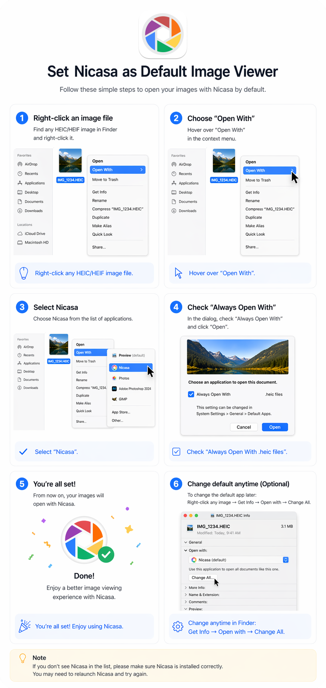

# Nicasa als Standard-Bildbetrachter festlegen

Folge diesen einfachen Schritten, um deine Bilder standardmäßig mit Nicasa zu öffnen.

## Schritt 1 —— Rechtsklick auf eine Bilddatei
Suche im Finder ein beliebiges HEIC/HEIF-Bild und rechtsklicke darauf.

Tipp: Rechtsklicke auf eine beliebige HEIC/HEIF-Bilddatei.

## Schritt 2 —— „Öffnen mit“ wählen
Fahre im Kontextmenü über „Öffnen mit“.

Tipp: Fahre über „Öffnen mit“.

## Schritt 3 —— Nicasa auswählen
Wähle Nicasa aus der Liste der Anwendungen.

Tipp: Wähle „Nicasa“.

## Schritt 4 —— „Immer öffnen mit“ aktivieren
Setze im Dialog ein Häkchen bei „Immer öffnen mit“ und klicke auf „Öffnen“.

Tipp: Setze ein Häkchen bei „Immer mit .heic-Dateien öffnen“.

## Schritt 5 —— Fertig!
Ab jetzt werden deine Bilder mit Nicasa geöffnet.

Tipp: Fertig! Viel Spaß mit Nicasa.

## Schritt 6 —— Standard jederzeit ändern (optional)
Um die Standard-App später zu ändern:

Rechtsklicke auf ein beliebiges Bild → Informationen → Öffnen mit → Alle ändern

Tipp: Jederzeit im Finder änderbar: Informationen → Öffnen mit → Alle ändern

**Hinweis**
Wenn Nicasa nicht in der Liste erscheint, stelle sicher, dass Nicasa korrekt installiert ist. Möglicherweise musst du Nicasa neu starten und es erneut versuchen.
